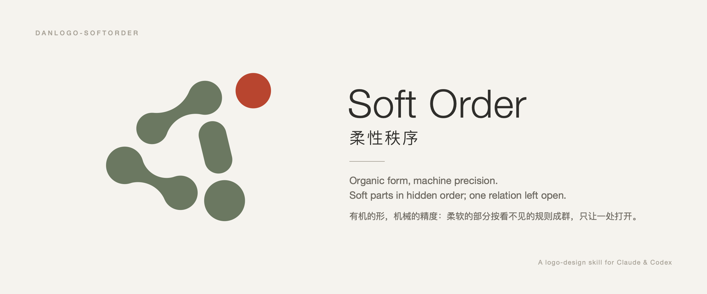
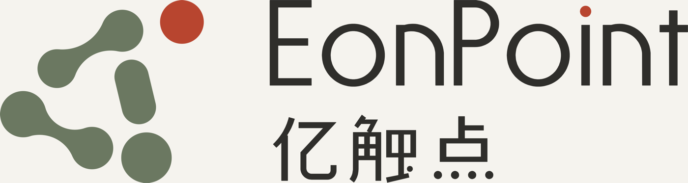
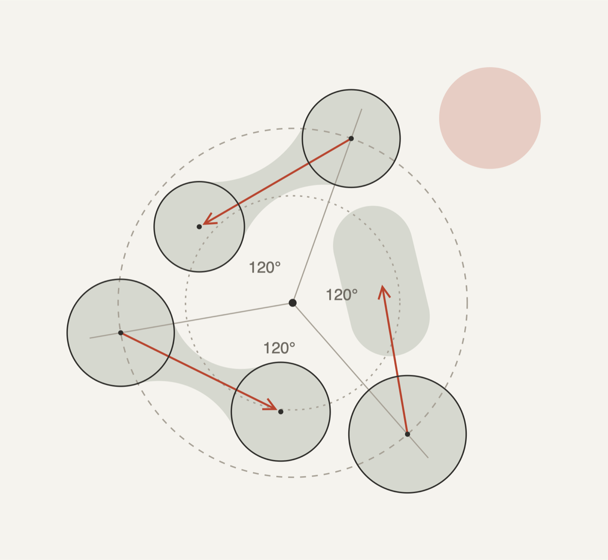
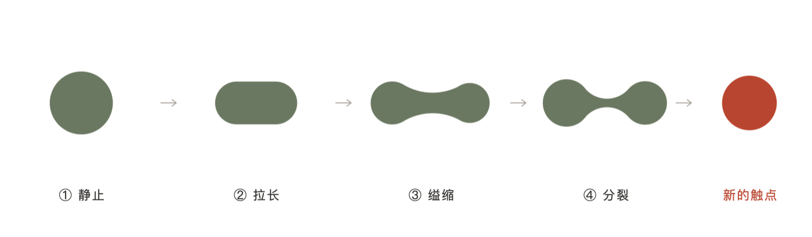
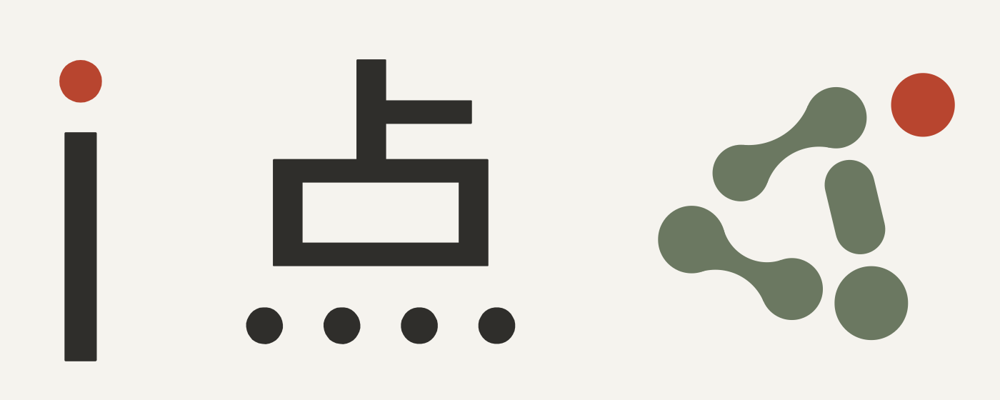
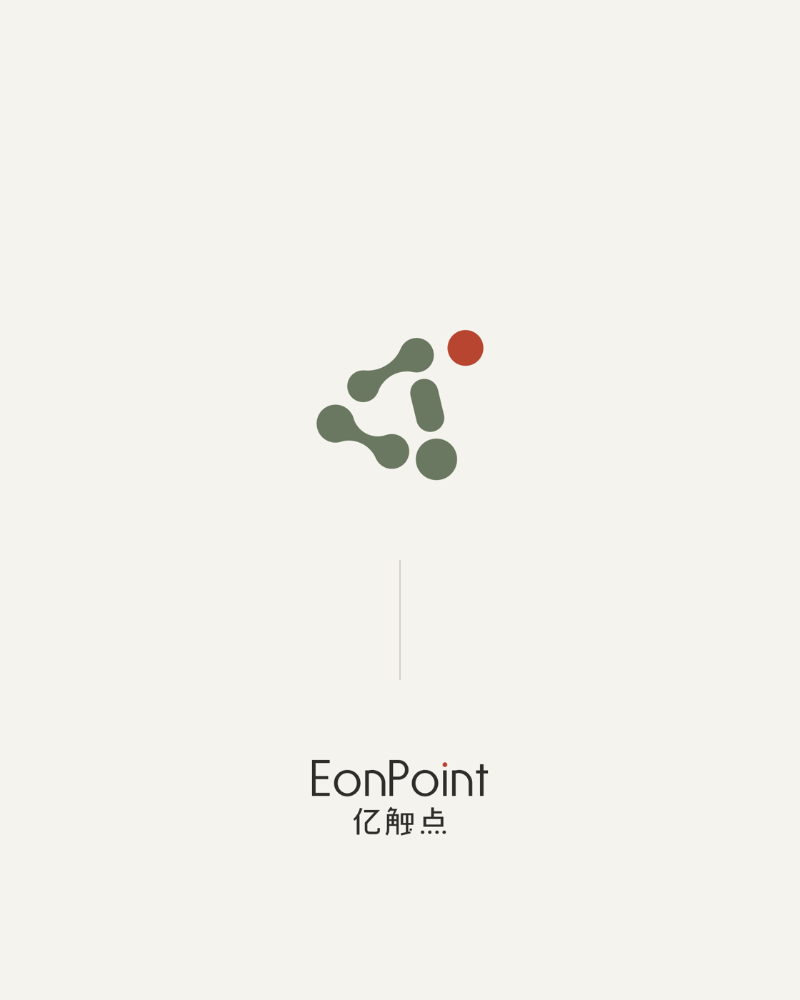
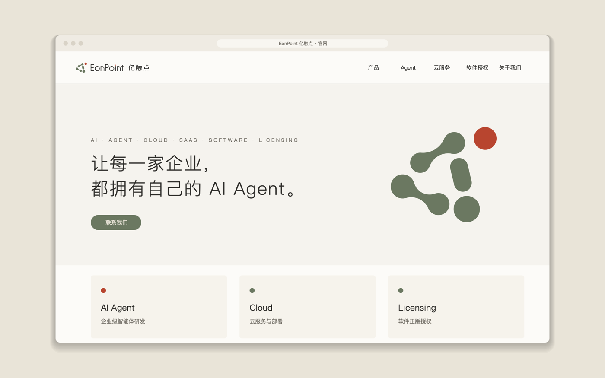
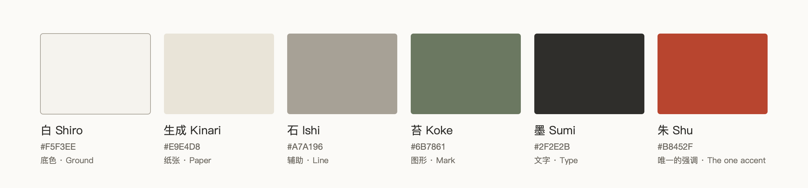
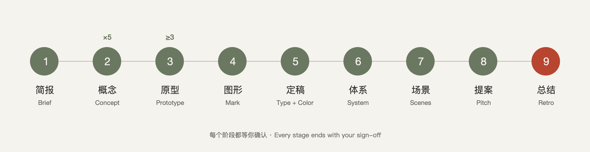

# danlogo-softorder · Soft Order

English · [中文](README.zh-CN.md)



> Organic form, machine precision: grown softly, arranged exactly; something is still happening, and one thing is left open.

The Soft Order direction of the danlogo series: a logo and brand-identity design skill for AI tools. It bundles a design style, a nine-stage working method and a set of drawing tools. The style's roots are the *Book of Changes* idea of ceaseless generation (生生), Xie He's "spirit resonance" (气韵生动), D'Arcy Thompson's *On Growth and Form*, organic abstraction and organic modernism, and Karl Gerstner's programmatic design. It was distilled from the EonPoint 亿触点 "01 Yuansheng" identity. It works with Claude (Claude Code, desktop, claude.ai), Codex, and any tool that reads the [Agent Skills](https://agentskills.io) format.

It fixes **character and quality**, not shapes, colours or techniques: every new brand grows its own process and its own form.

## The style

**Lineage**: the forms of biomorphic abstraction (Arp, Hepworth, Moore, Calder), the order of programmatic design (Gerstner), and colours named in the East Asian tradition. **Not tied to any industry**: choose it for the aesthetic. The industry only changes where the motif comes from.

**Locked formal language**: arcs with continuous curvature, modules in a group, contrast (soft form against firm type, overall order against one open relation, muted colours against one accent), flat planes, and an invisible order. Which forms, how many, and what process they tell are worked out fresh for each brand.

**Core relation: the group and the one that leaves.** A few soft parts share one invisible set of rules for size, spacing and joins. Together they read as one figure and one process that is still under way. Exactly one relation is left open, and all the tension and emphasis sit there.

| Gene | In one line |
|---|---|
| Soft | Continuous curvature; no corners |
| Hidden order | The rules can be written down, but the grid can't be seen; each part keeps a minimal offset |
| Group | Parts in proportion, never equal, forming a single figure |
| Interval | Spacing has a rhythm, joins grow rather than attach, and the rhythm breaks in one place only |
| In progress | You can read what is happening, not what has finished |
| Departure | One relation opens; the focus survives in greyscale |
| Soft form, firm type | Lettering is drawn from scratch: geometric and quiet, with a single echo of the mark |
| Colours named after things | Low-saturation colours with a source, and one accent |

It sits between two failures. If you can't state the rules, it looks pieced together. If you can see the grid, it looks rigid.

## Case: EonPoint 亿触点 "01 Yuansheng"

Borrow the method, not the form. The shapes, process, colours and lettering in the case answer that brand's brief; they are not rules of the style.

| | |
|---|---|
|  |  |
| Lockup: mark + bilingual wordmark "Su", drawn from scratch | Hidden order: two orbits, three axes, size progression, area conservation, equal gaps and φ |
|  |  |
| Process: read counter-clockwise as one division, with the last part just leaving | Soft form, firm type: the only echo is the round dot |
|  |  |
| Poster: wide white space, one accent | Website hero |

Case palette (an example only):



## Nine stages



1. Brief
2. Concepts (5 per round)
3. Prototypes (at least 3 per concept)
4. Mark refinement
5. Final type and colour
6. System
7. Scenes
8. Pitch
9. Retro

Every stage waits for your sign-off. In stage 9 the AI asks whether the project should be folded back into the skill.

## What's inside

```
SKILL.md                     entry: positioning, three layers of requirements, nine stages
PROMPT-CARD.md               style prompt card for any AI without the skill installed
references/
  philosophy.md              style ch. 1: lineage of ideas
  exemplars.md               style ch. 1 appendix: reference works and how to read them
  style-dna.md               style ch. 2: core relation, eight genes, knobs, touchstones
  creative-methods.md        style ch. 3: methods, concept cards, anti-homogenisation
  style-extension.md         style ch. 4: system, scenes and pitch aesthetics
  workflow.md … feedback-playbook.md   five shared danlogo-core chapters
cases/eonpoint-yuansheng/    the case
examples/eonpoint-yuansheng/src/  full generator code for the case (learn the craft, don't reuse the forms)
scripts/                     shared tools + soft-geometry tools (tangent joins, minimal-offset solver, lettering engine)
adapters/                    Claude vs Codex differences
agents/openai.yaml           Codex display info
evals/                       test briefs and records
install.sh                   install / update / package
```

## Install

```bash
git clone https://github.com/dan-cube/danlogo-softorder.git
cd danlogo-softorder
./install.sh            # installs to Claude Code (~/.claude/skills) and Codex (~/.agents/skills)
```

- One tool only: `./install.sh claude` or `./install.sh codex` (restart Codex afterwards).
- claude.ai: run `./install.sh package`, then upload `dist/danlogo-softorder.skill` in claude.ai's skill settings.
- The lettering tools need shapely: `python3 -m venv .venv && .venv/bin/pip install shapely` (see `scripts/README.md`).

## Use

Just ask, for example: "Design a logo for <brand> in the Soft Order style." The AI works through the nine stages and waits for you at each one. In Codex you can call it explicitly with `$danlogo-softorder`.

## Updating

- All changes are made in this repository. Update a local install with `git pull && ./install.sh`.
- At the end of each project (stage 9) the AI asks whether to add the project to the skill. Nothing is written without your approval, and `VERSION` and `CHANGELOG.md` are updated with every change.
- The five `danlogo-core` chapters in `references/` are maintained by the danlogo series standard and are not edited in individual skills.

## Privacy

The case shows the brand name and the design work. The company's full legal name, partners, trademark filings and contact details are not part of this repository.

## License

The skill's text and code are released under the [MIT License](LICENSE): you may use, copy, modify and redistribute them, including commercially, as long as the copyright notice and licence text travel with them.

The EonPoint 亿触点 name, marks, custom lettering and case images belong to their owner, as do the marks and letterforms drawn by the code in `examples/eonpoint-yuansheng/` and the images in `docs/images/` that show them. They are included as a case study only and are **not** covered by the MIT License; please don't reuse them. You can learn from how that code is written, but not reuse its shapes or letterforms.
