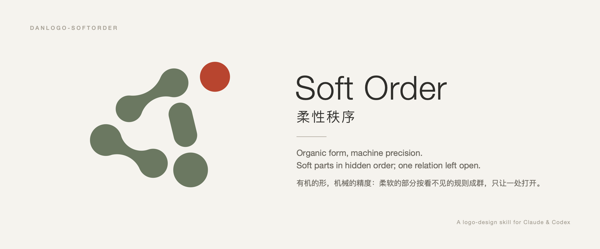
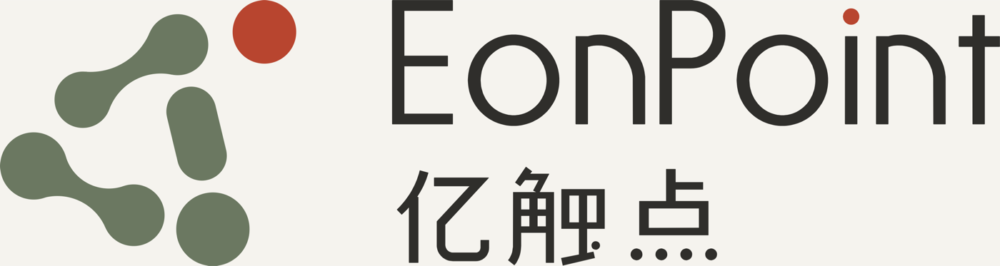
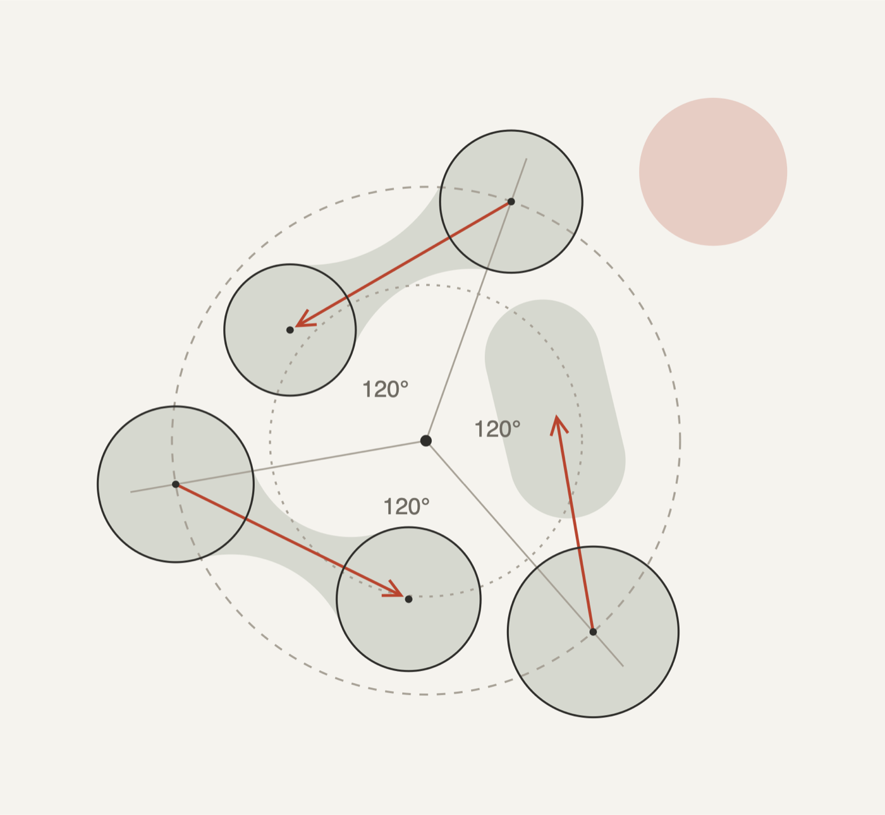
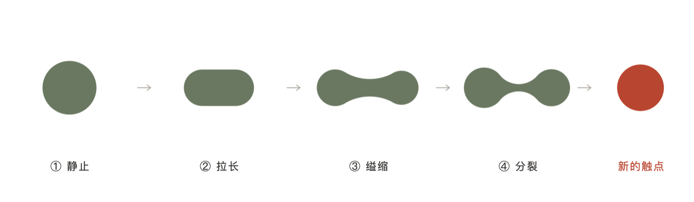
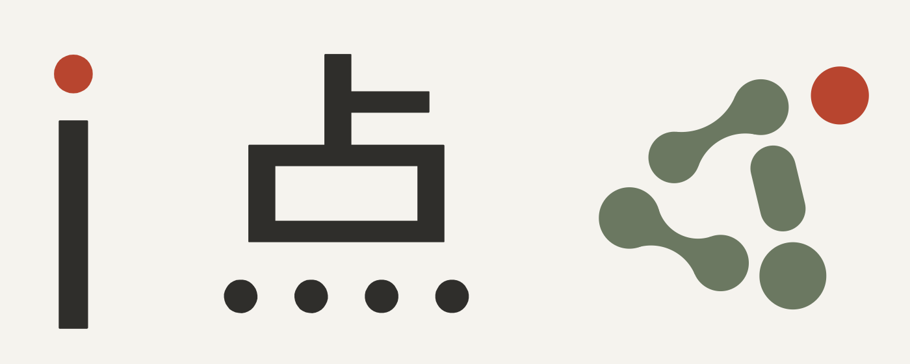
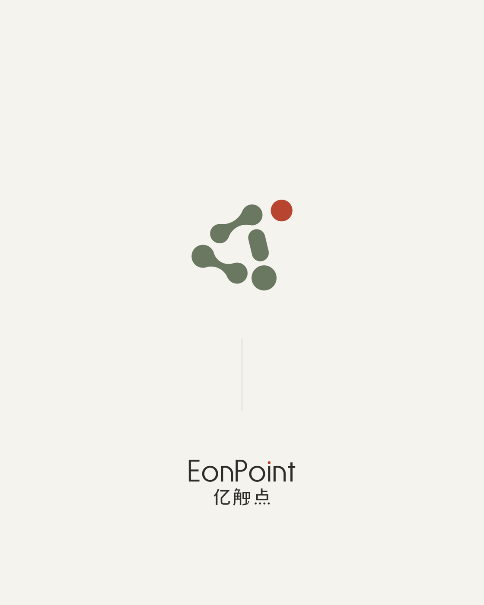
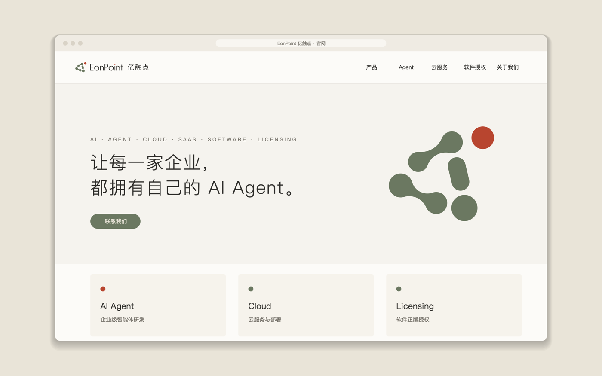
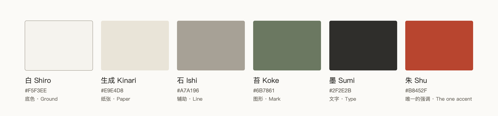
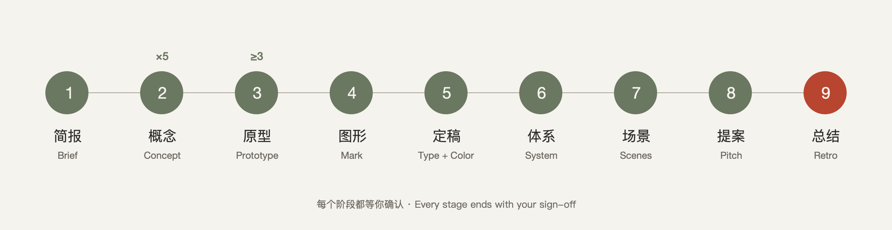

# danlogo-softorder · 柔性秩序

[English](README.md) · 中文



> 有机的形，机械的精度：柔软地长出来，精确地排好；正在发生，只留一处未完成。

danlogo 系列的柔性秩序方向：一个给 AI 用的 logo / 品牌标志设计 skill。它包含一种设计风格（以《周易》“生生”为根，经由谢赫“气韵生动”、达西·汤普森《生长与形态》、有机抽象与有机现代，到格斯特纳的程序化设计）、一套九阶段工作方法和一组绘图工具。沉淀自 EonPoint 亿触点「01 原生」方案，适用于 Claude（Claude Code、桌面版、claude.ai）与 Codex，以及其他支持 [Agent Skills](https://agentskills.io) 格式的工具。

它规定**气质和质量**，不规定形状、颜色或工艺：每个新品牌都从自己身上长出新的过程和新的形。

## 这个风格是什么

**属于哪一路**：生物形态抽象（阿尔普、赫普沃斯、摩尔、考尔德）的形 + 程序化设计（格斯特纳）的秩序 + 东亚传统色名的配色。**不限行业**：按审美选用，行业只影响母题从哪里来。

**锁定的形式语言**：圆弧（曲率连续）· 模块成群 · 对比（软形硬字、整体秩序对一处打开、低饱和对一处强调）· 平涂的面 · 看不见的秩序。具体用什么形、几个、讲什么过程，每个品牌重新长出来。

**核心构成：群与离。** 几个柔软的部分，大小、间隔、连接都服从同一套看不见的规则，合成一个图形、读成一个正在发生的过程；只有一处关系被打开，张力和强调都在那里。

| 基因 | 一句话 |
|---|---|
| 柔 | 轮廓曲率连续，没有拐角 |
| 隐秩 | 规则写得出，眼睛看不出网格；个体保留最小的偏差 |
| 群 | 几个部分成比例而不相等，合成一个图形 |
| 间 | 间隔有节律，连接是长出来的，只在一处打破 |
| 行 | 读得出正在发生，而不是已经完成 |
| 离 | 只打开一处；去色后焦点仍在 |
| 软形硬字 | 字从零绘制，几何、安静，与图形只有一处呼应 |
| 色以物名 | 低饱和、有出处的颜色，强调只有一处 |

它站在两种失败中间：列不出规则，是**拼搭感**；看得见网格，是**死板**。

## 案例：EonPoint 亿触点「01 原生」

只借方法，不借形式。案例里的具体形状、过程、颜色和字，都是那个品牌的答案。

| | |
|---|---|
|  |  |
| 组合：图形 + 从零绘制的中英文字标“素” | 隐藏的规则：两条轨道、三向轴、大小递进、面积守恒、等距与 φ |
|  |  |
| 过程：逆时针读成一次分裂，最后一个刚刚离开 | 软形硬字：唯一的呼应是正圆的点 |
|  |  |
| 海报：大面积留白，只亮一处 | 官网首屏 |

案例色系（只作示例）：



## 九个阶段



简报 → 概念（每轮 5 套）→ 原型（每个概念 ≥3 套）→ 图形精修 → 定稿（定制字 + 配色）→ 体系 → 场景 → 提案 → 总结。每个阶段都等你确认；第 9 阶段会询问是否把这个项目沉淀进 skill。

## 里面有什么

```
SKILL.md                     入口：定位、三层要求、九个阶段、贯穿规则
PROMPT-CARD.md               风格提示词卡：可以单独贴给没有安装 skill 的 AI
references/
  philosophy.md              风格章 1：思想坐标
  exemplars.md               风格章 1 附录：参照作品与示范用法
  style-dna.md               风格章 2：群与离、八条基因、旋钮、试金石
  creative-methods.md        风格章 3：创意方法、概念卡、防同质化
  style-extension.md         风格章 4：体系、场景、提案的审美
  workflow.md                共用：九阶段细则、decisions.md、编号
  quality-gates.md           共用：质量关卡、查重、审看
  craft.md                   共用：构造、定制字、配色研究、导出
  deliverables.md            共用：体系、场景、提案、交付包
  feedback-playbook.md       共用：反馈 → 诊断 → 动作
cases/eonpoint-yuansheng/    案例
examples/eonpoint-yuansheng/src/  案例的完整生成代码（学写法，不复用造型）
scripts/                     通用工具 + 本风格的柔性几何工具（相切过渡、最小偏差求解、定制字引擎）
adapters/                    Claude 与 Codex 的使用差异
agents/openai.yaml           Codex 的显示信息
evals/                       测试简报与记录
install.sh                   安装 / 更新 / 打包
```

## 安装

```bash
git clone https://github.com/dan-cube/danlogo-softorder.git
cd danlogo-softorder
./install.sh            # 同时装到 Claude Code（~/.claude/skills）和 Codex（~/.agents/skills）
```

- 只装一个：`./install.sh claude` 或 `./install.sh codex`（Codex 需重启后生效）。
- claude.ai：`./install.sh package`，把 `dist/danlogo-softorder.skill` 上传到 claude.ai 的技能设置里。
- 字标工具需要 shapely：`python3 -m venv .venv && .venv/bin/pip install shapely`（见 `scripts/README.md`）。

## 使用

直接说需求，例如：“用柔性秩序的风格，给『某某品牌』做一个 logo。”AI 会按九个阶段推进，每个阶段都等你确认。在 Codex 里可以用 `$danlogo-softorder` 显式调用。

## 更新

- 修改都在本仓库进行；`git pull && ./install.sh` 更新本机安装。
- 每个项目结束时（第 9 阶段），AI 会询问是否把这个项目沉淀进来。你批准后才写入，并更新 `VERSION` 与 `CHANGELOG.md`。
- `references/` 中标有 `danlogo-core` 的五个共用章节由 danlogo 系列标准统一维护，不在单个 skill 里单独改。

## 隐私

案例展示品牌名与设计成果；企业的法定全称、合作方、商标申请细节与联系方式不进入本仓库。

## 许可

本 skill 的文字和代码采用 [MIT 许可](LICENSE)：可以自由使用、复制、修改和再分发，包括商用，只要保留版权声明和许可全文。

EonPoint 亿触点的名称、标志、定制字与案例图片归其所有者所有，`examples/eonpoint-yuansheng/` 中的代码画出的标志与字形、`docs/images/` 中展示它们的图片也一样。这些内容仅作案例展示，**不在 MIT 许可范围内**，请勿挪用。那份代码的写法可以学习，造型与字形不能复用。
