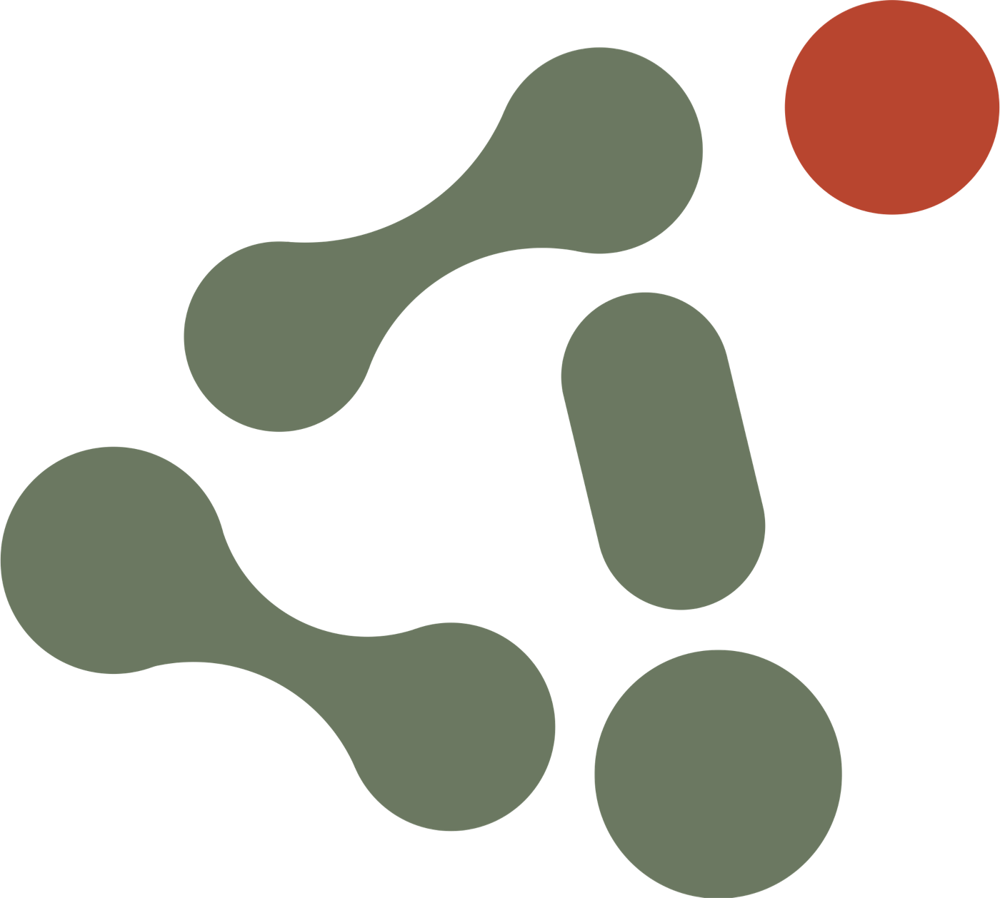
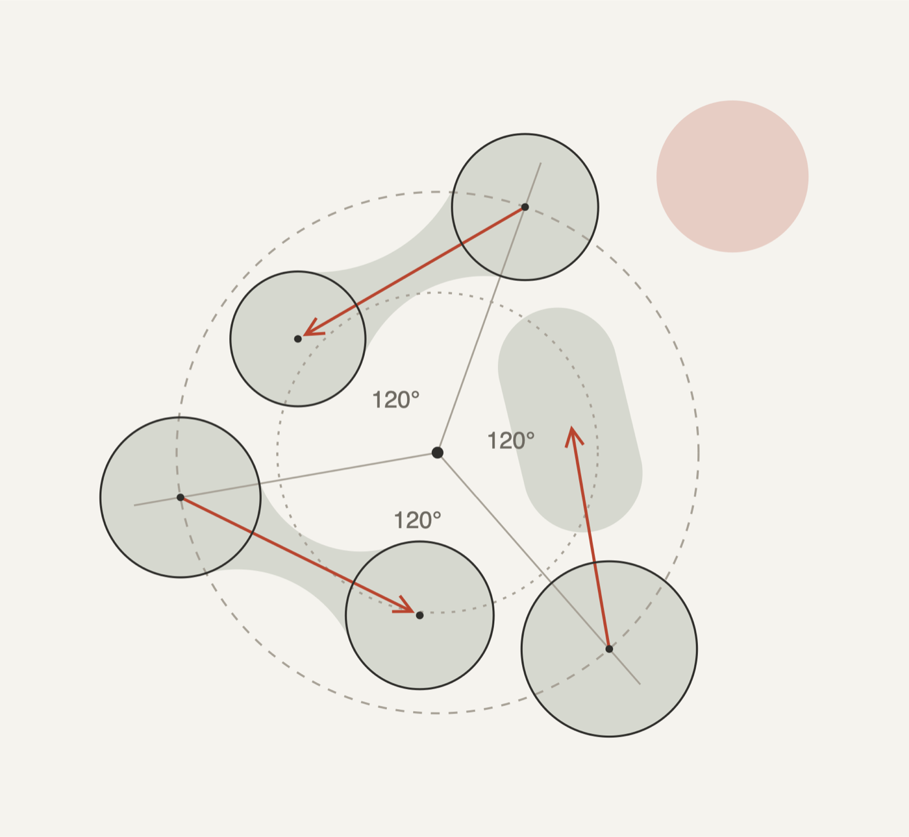
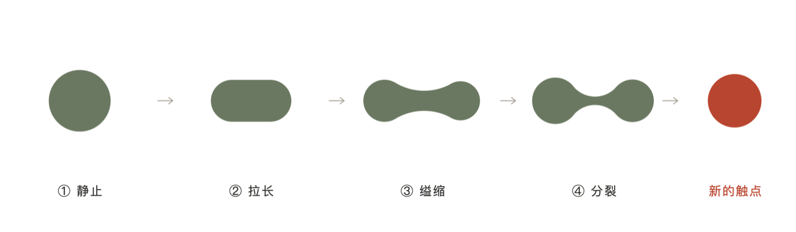
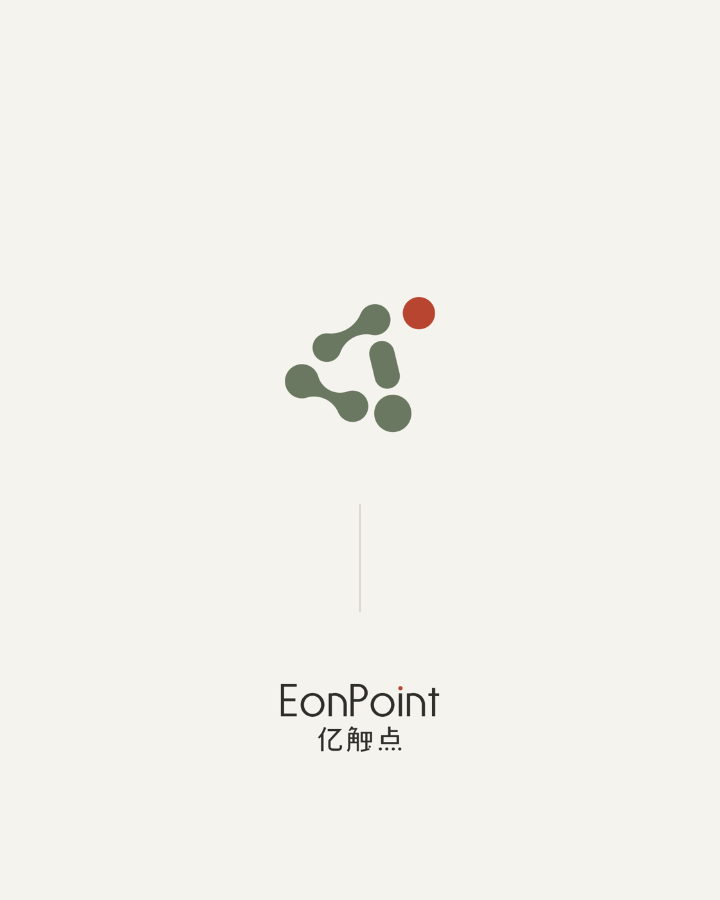
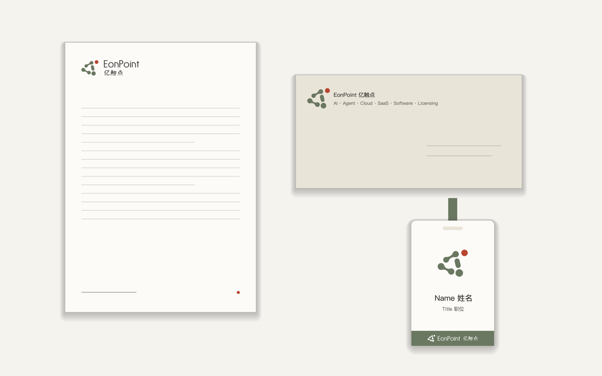
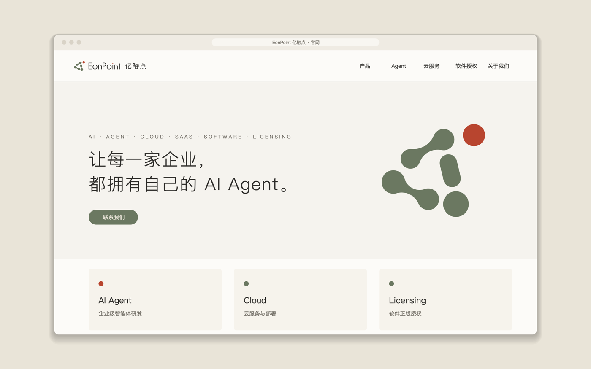

# 案例 · EonPoint 亿触点 ·「01 原生」

> **只借方法，不借形式。** 这里的分裂过程、圆与相切的颈、回旋构图、苔绿与朱色、字标“素”，都是 EonPoint 这个品牌的答案，不是柔性秩序的规定。读它是为了看风格和质量落在一个真实品牌上是什么程度，不是为了复制造型。新项目的过程（母题）和群与离的具体安排，都不能与本案相同（见 `../index.md`）。

> EonPoint 亿触点的名称、标志、定制字与本案例图片归其所有者所有，`examples/eonpoint-yuansheng/` 中的代码画出的标志与字形也一样。这些内容仅作案例展示，不在本仓库 MIT 许可范围内。

## 1 简报

- **品牌**：EonPoint 亿触点，面向企业的 AI 服务商：自研 Agent，并提供云服务、SaaS 与软件授权。业务描述：AI · Agent · Cloud · SaaS · Software · Licensing。
- **用户带来的**：一张 AI 生成的参考图——几个绿色的软体相连，旁边一个亮绿的点，下面是品牌名。
- **用户原话**：“我喜欢他这种原子分子或者细胞分裂的这种状态，结合点这个核心概念。但是我总觉得不够成熟，符号化不强，艺术潮流感不高，整体不像一个成熟的logo，而是过于AI味和拼搭感。”“在不改变设计理念的基础上……让他更具备AI硅谷大厂的logo气质。”
- **要**：保留分裂的状态和“点”的概念；成熟、有标志感、国际化。**不要**：AI 味、拼搭感；后来又加上：老土的商务风、现成字体。

## 2 过程

| 轮 | 做了什么 | 用户原话 | 教训 |
|---|---|---|---|
| 一 | 把参考图重建在严格的网格上：三向对称、分子式、有丝分裂三套 | “我觉得你修改的反而过于规整，失去了一些设计的美感和灵动性。我的原版其实是不规则中蕴含着规则，这样会更有 Logo 感。” | 秩序不能露在表面。→ 基因“隐秩”、方法“最小偏差” |
| 二 | 先**测量**原参考图，发现它本来就隐约遵守一套规则（两条轨道、三向轴、整体扭转、大小递进、读成一次分裂）；把规则做精确，每个部分只保留最小的偏差。三种力度：原生 / 周期 / 凝聚 | 锁定“01 原生”；“目前的中英文字体是非常不好看的”；“我不要老土的商务风” | 规则从作品里找，不从外面套。→ 方法“先写规则，再出形” |
| 三 | 三套定制字（出芽 / 分裂 / 触点）× 三套色系（硅谷 / 先锋 / 原研） | “我需要自己设计字体……不要用现有的一些字体。”“选用原研哉的色系，但是英文和中文字体太负责（复杂）了，繁琐了，重新设计吧。” | 字不要跟着图形做花样。→ 基因“软形硬字” |
| 四 | 去掉一切装饰的三套字：素 / 轻 / 间；唯一的呼应是“正圆的点” | 认可“素”+ 原研色系：“按照这个进行最后检查和微调，提升完整度。” | 字安静，图形的柔软才显得有意 |
| 定稿 | 微调字的肩部与交接、缩小中文点画；体系、八类场景、38 页提案 | “我很喜欢这套设计思路” | 整套设计出自同一套规则 |

## 3 最终方案

**图形“01 原生”**：五个柔软的体——两组以细颈相连的“双体”、一个拉长的体、一个圆——沿逆时针排成一个开口的回旋；另有一个最小的体沿切线方向离开主体，是全套唯一的强调色。没有一个锐角，没有两个等大的部分。

**隐藏的规则**（看不见网格，但处处有依据）：

1. 两条轨道：外轨 3 个、内轨 3 个，各按 120° 排布，内轨整体扭转约 −70°；每个部分只保留不超过 7° 的个体偏差。
2. 大小递进：外轨沿回旋方向每一个 ×1.095；与之相连的子体 = 母体 × 0.923。
3. 面积守恒：拉长的体面积 = 最大的圆。
4. 等距：三处分离缝隙完全相等；左侧开口 = 缝隙 × φ。
5. 颈部递变：沿分裂顺序，颈宽从 0.32 收到 0.27，然后断开。
6. 离开的那一个沿外轨切线方向偏出，“将触未触”。

**故事**：逆时针读，就是一次分裂——静止、拉长、缢缩、分开——离开的那一个是新生的“触点”。“从一个点，到亿个触点。”

**字标“素”**：中英文从零绘制的几何无衬线。EonPoint 首字母大写；横画略细于竖画（视觉修正）；字碗为正圆；字距偏松。中文“亿触点”同一分量，笔画繁的“触”单独减重；撇、提渐细。唯一的呼应：字里的点画都是正圆，i 的点用强调色。

**色彩“原研”**：白 #F5F3EE · 生成 #E9E4D8 · 石 #A7A196 · 苔 #6B7861 · 墨 #2F2E2B · 朱 #B8452F（深色底上用 #C8563F）。用量约为：白 62% · 生成 20% · 苔 7% · 石 6% · 墨 4% · 朱 < 1%。

**体系与场景**：见 `references/style-extension.md` 的“案例”一节。

## 4 反向拆解对照

| 风格要求 | 在本案中的体现 |
|---|---|
| 核心构成：群与离 | 五个体按同一套规则成群；一个最小的体离开，成为唯一焦点 |
| 柔 | 全部由圆与相切圆弧构成，轮廓曲率连续，没有一个折点 |
| 隐秩 | 两条轨道、三向轴、大小递进、面积守恒、等距与 φ；个体偏差不超过 7° |
| 群 | 5 个体合成一个开口的回旋；模糊后是一个团块 |
| 间 | 三处缝隙等宽，开口为 φ 倍；连接是逐渐变细的颈，不是杆 |
| 行 | 逆时针读成一次分裂，停在最后一个刚离开的时刻；镜像后方向改变 |
| 离 | 去色后，离开的那一个仍是焦点；强调色只给它 |
| 软形硬字 | 字标“素”无装饰，只与图形共用“正圆的点” |
| 色以物名 | 六色都以材料与物命名；朱只出现在一处 |

## 5 旋钮取值

造型语言：分开的体（圆与相切弧）· 部分数量：5 + 1 · 软硬度：柔几何 · 过程：分裂 · 强调：一个部分离开（唯一着色）· 力度：中 · 色温：暖 · 字：几何、首字母大写 · 构图：回旋、开口 · 材料想象：纸、陶、植物。

## 6 可以借的方法

- **测量之后再设计**：用户带来的参考常常已经“隐约有规则”；先量出来，再把它做精确，比另起炉灶更能守住用户喜欢的东西。
- **最小偏差求解**：先让规则精确成立，再用求解器找出“让规则成立所需的最小改动”，外观几乎不变，可信度大增。
- **规则写成参数**：所有尺寸来自一个基准和几个比值；构造图直接由同一份代码画出，成为提案里最有说服力的一页。
- **字的视觉修正**：横细于竖、内碗收窄、肩部过渡、繁笔画的字单独减重。
- **只给一处强调**：强调先由“离开”这个位置关系成立，颜色只加强。

## 7 查重结论

定稿阶段只做了人工的视觉对照：没有发现与它近似的已知标志；“几个圆围绕中心”的旋转群组是常见的构成方式，本案的区别在于连接的颈、大小递进与离开的那一个。**没有做系统的网络查重，也没有做商标检索**；正式注册前需由商标代理检索。

## 8 文件

- `images/`：01 组合 · 02 图形 · 03 隐藏的规则 · 04 分裂过程 · 05 字与图形的呼应 · 06 海报 · 07 办公用品 · 08 官网。
- `../../examples/eonpoint-yuansheng/src/`：完整生成代码——`marks4.py`（图形模型、拟合、最小偏差）、`cells.py` / `geo.py`（相切的颈与群组）、`type5.py`（字的笔画引擎）、`en6.py` / `cn5.py`（中英文字形）、`lockup6.py`（组合与配色）、`poster6.py`（海报、名片、图标）、`assets_deck.py`（构造图、规范图、场景示意）、`build6.py`（批量导出）。只学写法，不复用造型与字形。
